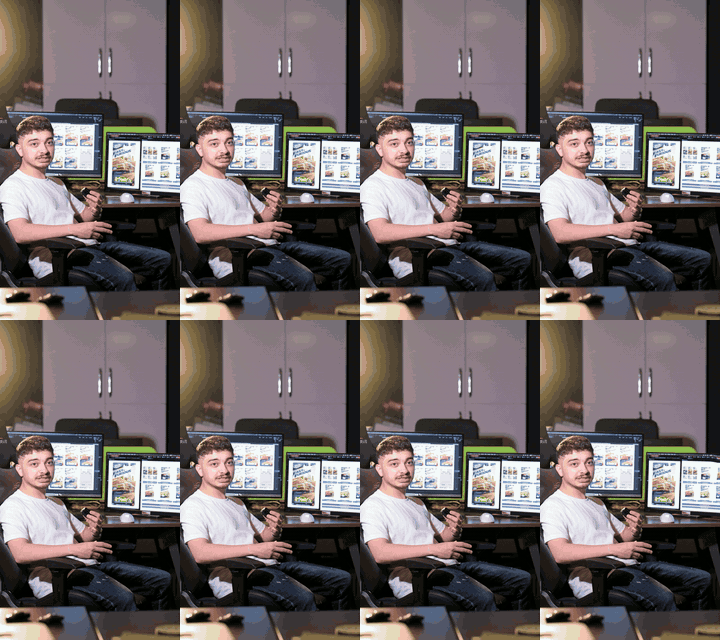
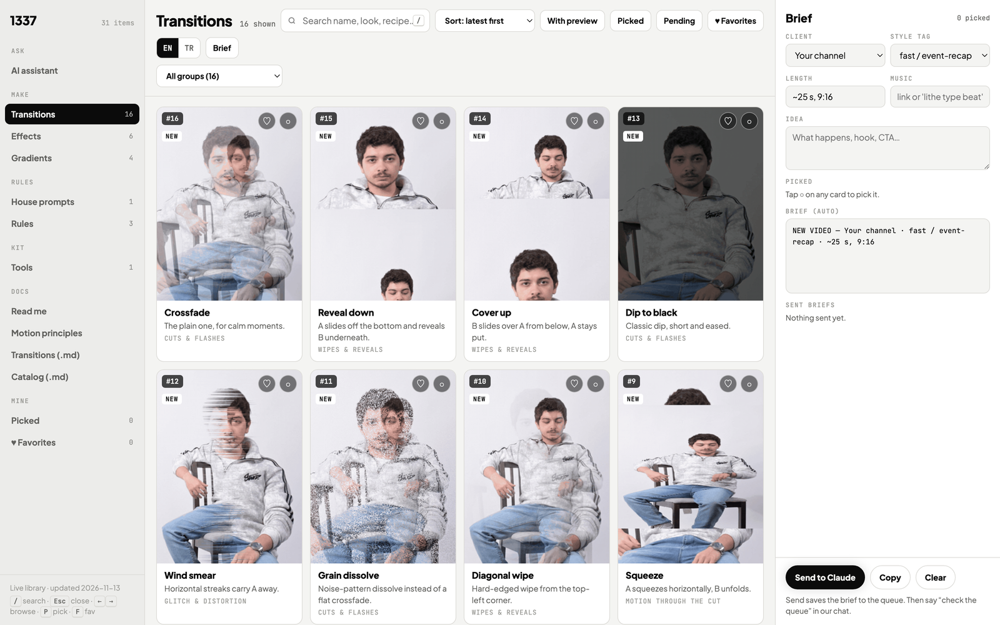
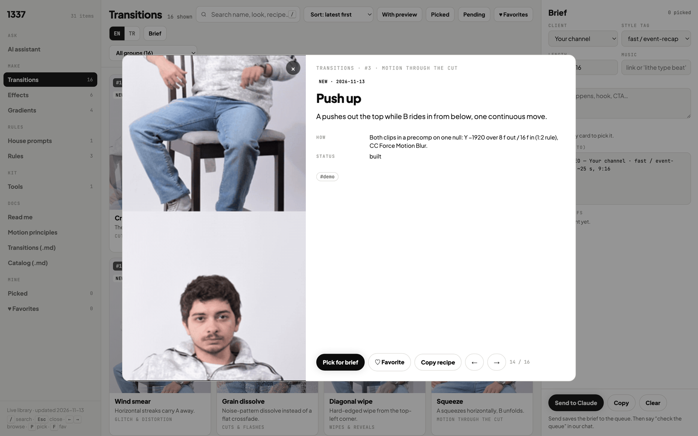
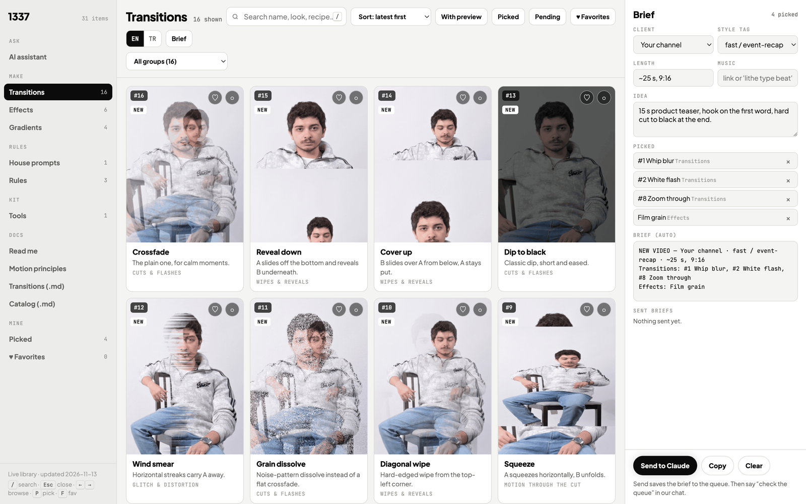
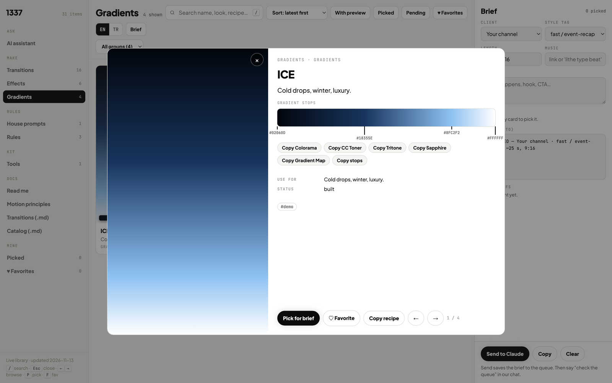
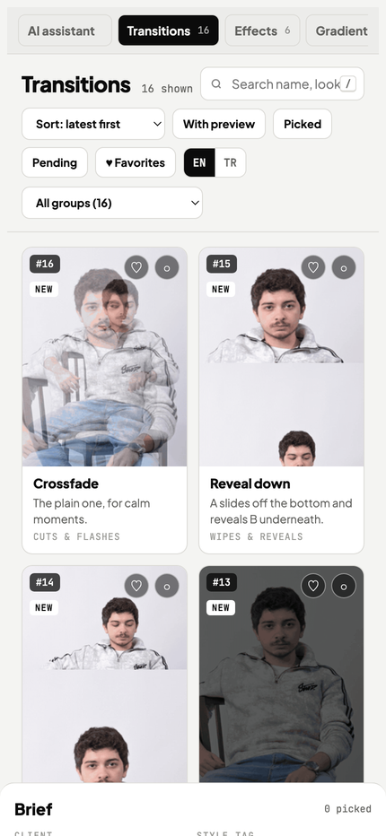
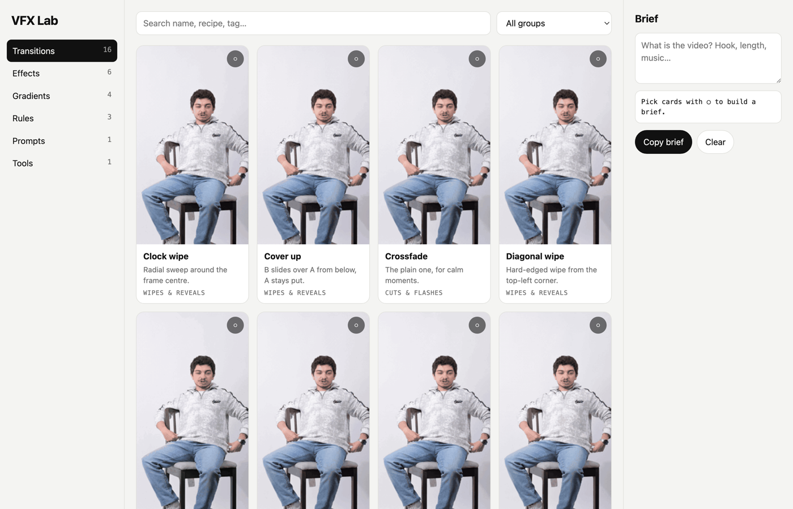

# 1337 VFX LAB

**My private motion-design library: every transition, effect, LUT, gradient and house rule I use, in one searchable app with live previews.** I pick what I want for the next video, it writes the brief, and my AI assistant builds it in After Effects.

This repo is the **showcase and the how-to**, not the app itself. The real one is private (client work lives in it). Here you get screenshots, the ideas behind it, and a small **starter you can run today** to build your own.



<sub>All previews here are re-rendered on my own footage, so no client work is shown.</sub>

---

## What it looks like

| Library | Detail sheet |
|---|---|
|  |  |
| **Brief builder**: pick cards, the brief writes itself | **Gradients**: stops + one-click copy for Colorama, Tritone, Sapphire… |
|  |  |

<p align="center"></p>

## What's in the real one

- **1,000+ entries:** transitions, effects, LUTs (with before/after sprite sheets), gradient maps, house text motions, templates, talking-head styles, music picks, sound treatments, rules and study guides.
- **A preview on every card** where possible: 2–3 s loops rendered from real edits, so you see the move, not a description of it.
- **Recipes, not vibes.** Every entry says *how*: effect names, values, frame counts, eases. Example: *"Directional Blur 0→150→0, 6 f out / 12 f in, Motion Tile mirror 300 %."*
- **Brief builder.** Tick ○ on the cards you want, type the idea, and press *Send*. The brief lands in a queue that my assistant reads ("check the queue"), then it builds the video from those exact pieces.
- **Built-in AI assistant** that only recommends things that exist in the library.
- **EN/TR** switch, favourites, sorting (newest, chef's choice, A–Z), collections per house style, and a Docs section (README, motion principles, full catalog).
- **Fed by research.** Tutorials and reference reels get broken down into new entries, so the library grows every week.

## Build your own

**→ [tutorial/BUILD_YOUR_OWN.md](tutorial/BUILD_YOUR_OWN.md)**: the full walkthrough (about 30 minutes to a working library).

Quick start with the starter in this repo:

```bash
cd starter
python3 make_catalog.py          # catalog/*.md  ->  catalog.js
open index.html                  # (Windows: start index.html)  no server, no build step
```



| File | What it does |
|---|---|
| `starter/catalog/**/*.md` | One Markdown file per technique (31 examples: 16 transitions, 6 effects, 4 gradients, rules). |
| `starter/make_catalog.py` | Turns the entries into `catalog.js`. No dependencies. |
| `starter/index.html` | The viewer: kinds, search, groups, preview cards, detail sheet, copy recipe, brief builder. One file. |
| `starter/make_previews.sh` | ffmpeg: cut a preview GIF from a render, or make an A→B demo of any `xfade` transition on your own plates. |
| `starter/contact_sheet.sh` | ffmpeg: QC a whole render as one tiled image at 3 fps. |

## Related

- [ae-motion-toolkit](https://github.com/GFXER/ae-motion-toolkit): the After Effects scripts many of these recipes point to.
- [video-fx-tools](https://github.com/GFXER/video-fx-tools): command-line helpers.
- [1337emoji](https://github.com/GFXER/1337emoji): free emoji-flood transition panel for Premiere Pro / After Effects.

## License

Code in `starter/`: MIT. Screenshots, previews and footage in `docs/`: © GFXER, all rights reserved, so please don't reuse them in your own library. Shoot your own plates (the tutorial shows how).
